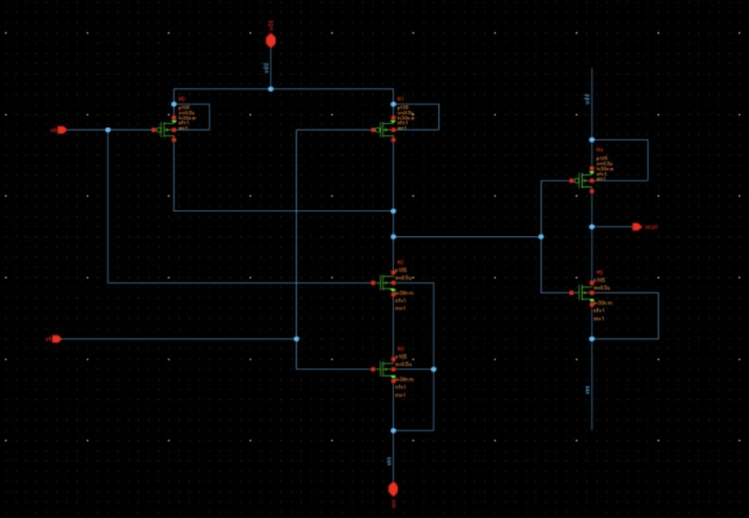
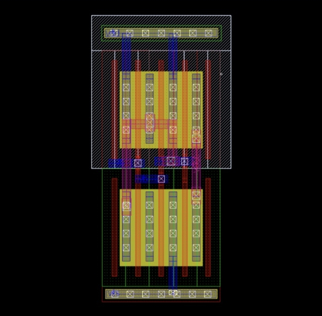
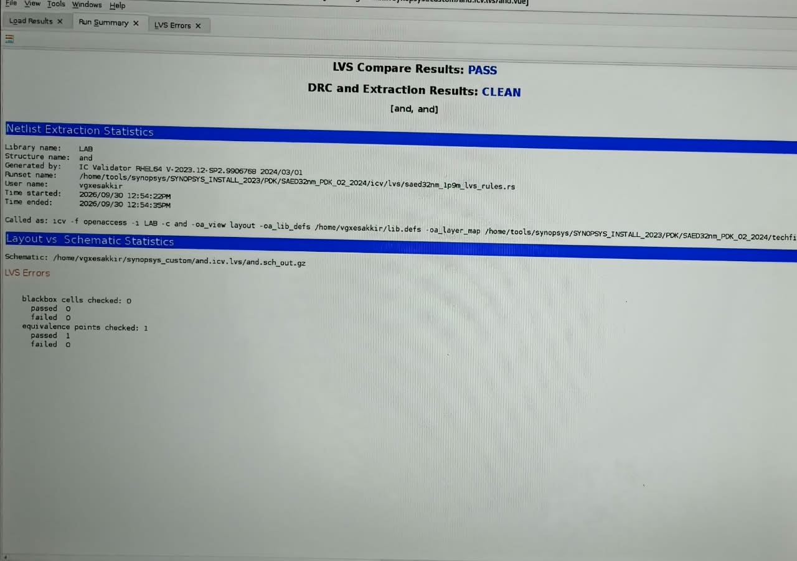
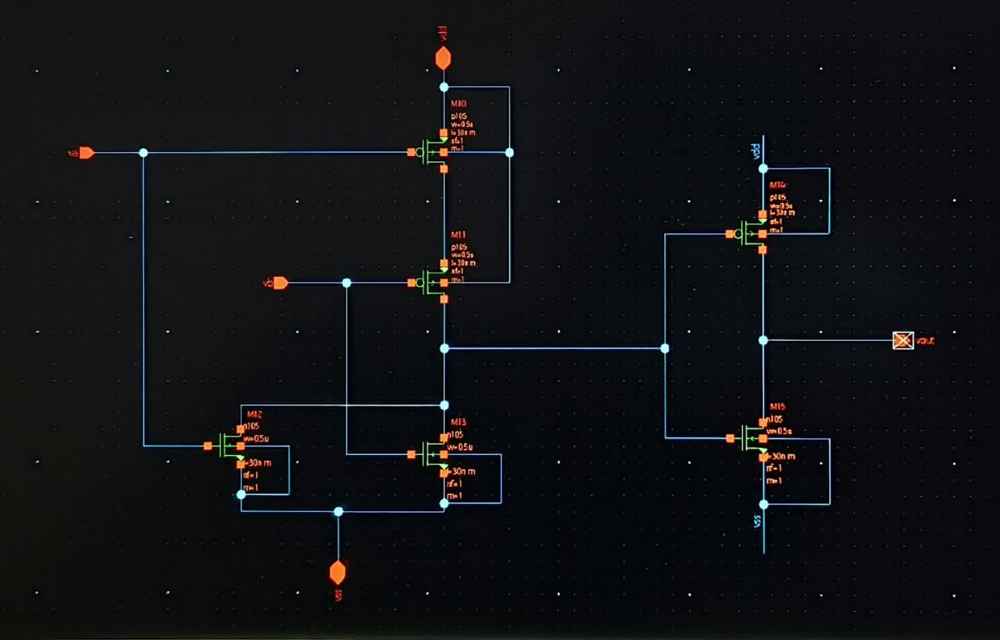
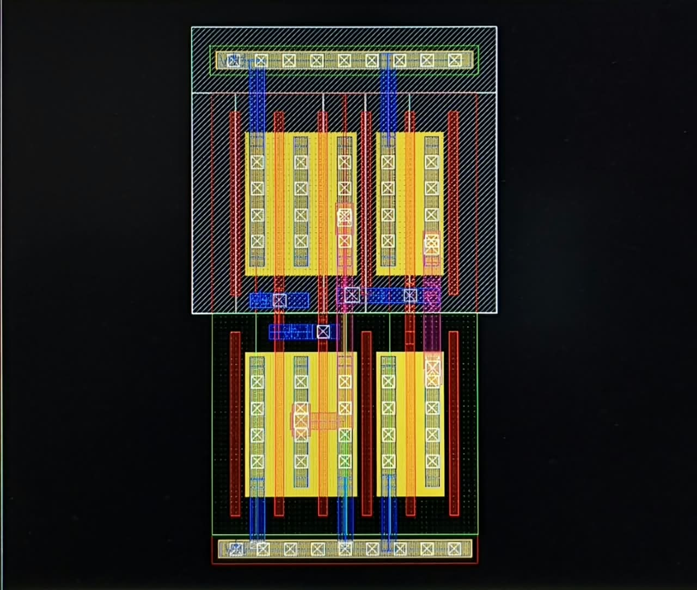
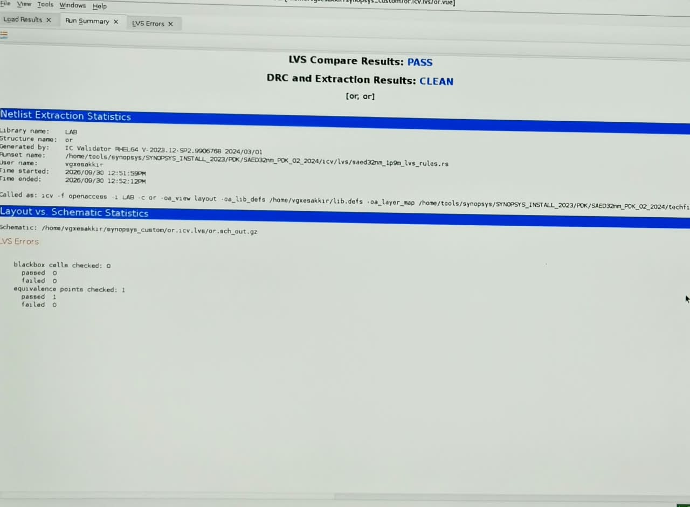

# CMOS AND & OR Logic Gates --- Schematic, Layout and LVS Verification

This repository contains the **CMOS schematic, physical layout, and LVS
verification results** for two basic combinational logic gates:

-   **2-input AND gate**
-   **2-input OR gate**

The designs were implemented and verified using a custom CMOS design
flow with schematic capture, layout, DRC/LVS verification, and
layout-versus-schematic comparison.

## Project Overview

The project demonstrates the complete digital IC design flow:

1.  Create the transistor-level CMOS schematic.
2.  Design the corresponding physical layout.
3.  Run DRC and extraction.
4.  Run LVS to compare the extracted layout netlist with the schematic.
5.  Confirm that the final layout matches the intended logic
    implementation.

Both gates have **clean DRC/extraction results** and **passing LVS
comparison**.

------------------------------------------------------------------------

## 1. AND Gate

### Logic Function

For a 2-input AND gate:

\[ Y = A `\cdot `{=tex}B \]

The output is HIGH only when **both inputs A and B are HIGH**.

### Schematic



### Layout

The layout shows the CMOS pull-up and pull-down transistor networks,
metal interconnects, contacts, and power rails.



### LVS / Verification

The LVS report shows:

-   **LVS Compare Results: PASS**
-   **DRC and Extraction Results: CLEAN**
-   Equivalence points checked: **1**
-   Passed: **1**
-   Failed: **0**



### AND Gate Truth Table

  A   B   Y = A·B
  --- --- ---------
  0   0   0
  0   1   0
  1   0   0
  1   1   1

------------------------------------------------------------------------

## 2. OR Gate

### Logic Function

For a 2-input OR gate:

\[ Y = A + B \]

The output is HIGH when **either A or B, or both, are HIGH**.

### Schematic



### Layout

The physical layout implements the CMOS transistor networks
corresponding to the OR-gate schematic.



### LVS / Verification

The LVS report shows:

-   **LVS Compare Results: PASS**
-   **DRC and Extraction Results: CLEAN**
-   Equivalence points checked: **1**
-   Passed: **1**
-   Failed: **0**



### OR Gate Truth Table

  A   B   Y = A+B
  --- --- ---------
  0   0   0
  0   1   1
  1   0   1
  1   1   1

------------------------------------------------------------------------

## 3. Design Flow

``` text
CMOS Schematic
      │
      ▼
Transistor-Level Design
      │
      ▼
Physical Layout
      │
      ▼
DRC + Parasitic Extraction
      │
      ▼
LVS Comparison
      │
      ▼
PASS / CLEAN
```

### Verification Summary

  Design   DRC / Extraction   LVS    Equivalence
  -------- ------------------ ------ -------------
  AND      CLEAN              PASS   1 / 1
  OR       CLEAN              PASS   1 / 1

------------------------------------------------------------------------

## 4. Repository Structure

A suggested GitHub repository structure is:

``` text
.
├── README.md
├── AND_schematic.jpeg
├── AND_layout.jpeg
├── AND_verification.jpeg
├── OR_schematic.jpeg
├── OR_layout.jpeg
└── OR_verification.jpeg
```

Keep the image files in the **same directory as `README.md`** so the
relative image links render correctly on GitHub.

------------------------------------------------------------------------

## 5. Tools and Technologies

-   CMOS transistor-level design
-   Schematic capture
-   IC physical layout
-   Design Rule Check (DRC)
-   Netlist extraction
-   Layout Versus Schematic (LVS)
-   Synopsys Custom Compiler / IC Validator flow
-   32 nm CMOS PDK environment

------------------------------------------------------------------------

## 6. Results

Both CMOS logic gates successfully completed the physical-design
verification flow.

### AND Gate

**DRC: CLEAN → LVS: PASS**

### OR Gate
**DRC: CLEAN → LVS: PASS**

The successful LVS comparison confirms that the extracted
transistor-level connectivity of each physical layout matches its
corresponding schematic.

------------------------------------------------------------------------

## Author

**Esakkiraj G**
B.E. Electronics and Communication Engineering
Custom & Analog Layout Trainee

**Domain:** VLSI | Custom Layout | Analog Layout | CMOS Design

